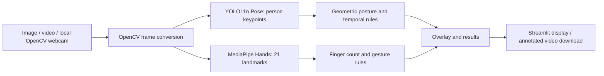

# AI-Based Full Body and Finger Movement Tracking

An academic demonstration app that annotates images and videos with human pose and hand landmarks, then applies readable geometric rules to estimate posture, raised hands, finger counts, and selected gestures. Live webcam mode also runs MediaPipe Face Detection to draw actual face boxes separately from YOLO's nose and eye keypoints.

## Problem and objectives

Manual inspection of posture and hand movement is slow. This project provides a visual computer vision pipeline for demonstrations, prototyping, and learning. It detects people with pretrained YOLO11n Pose and hands with MediaPipe Hands; it does not train on a user dataset.

## Use cases

- Inspect a single image and view body joints, hand landmarks, approximate posture, raised-hand state, and gesture/finger estimates.
- Annotate a video frame by frame and download the result with temporal movement labels.
- Run continuous OpenCV webcam tracking with Start Camera / Stop Camera controls and live body/hand overlays.

## Requirements and technologies

Python 3.10 or 3.11 is recommended. The app uses Python, Streamlit fragments, Ultralytics YOLO11n Pose, MediaPipe Hands, OpenCV, NumPy, Pillow, and the bundled FFmpeg executable from imageio-ffmpeg for H.264 video output. CPU inference is supported; Ultralytics can use a compatible GPU automatically when configured. The first model initialization downloads the YOLO weights and needs network access.

## Workflow



## Project structure

```text
app.py
camera_test.py           # probe camera indexes/backends without Streamlit or AI models
webcam_test.py           # live camera + MediaPipe face check without Streamlit/YOLO
requirements.txt
README.md
src/
  pose_detection.py
  face_detection.py
  hand_tracking.py
  person_tracking.py
  movement_analysis.py
  gesture_analysis.py
  visualization.py
  video_processing.py
  webcam_processing.py
tests/
  test_analysis.py
  test_video_processing.py
  test_webcam_processing.py
outputs/                 # optional local output location
```

## Setup (Windows PowerShell)

```powershell
py -3.11 -m venv .venv
.\.venv\Scripts\Activate.ps1
python -m pip install --upgrade pip
pip install -r requirements.txt
streamlit run app.py
```

If PowerShell blocks activation, run `Set-ExecutionPolicy -Scope Process -ExecutionPolicy Bypass` in that terminal, then activate the environment. The exact application command is `streamlit run app.py` from the project directory.

To probe webcam access independently of Streamlit and the detection models on Windows, run `\.venv\Scripts\python.exe camera_test.py`. It checks camera indexes 0 and 1 with DirectShow, Media Foundation, and OpenCV's default backend, releasing each probe handle before trying the next.

To test a live camera frame and MediaPipe face detection in a preview window without Streamlit or YOLO, run `\.venv\Scripts\python.exe webcam_test.py --index 0 --backend dshow`. Press **Q** or **Esc** to close it. Backend choices are `dshow`, `msmf`, and `default`.

## Use

Choose Image Upload Detection, Real-Time Webcam Detection, or Video Upload Detection in the sidebar. Upload JPG/JPEG/PNG for images and MP4/AVI/MOV/MKV for videos. Image mode shows the original and annotated image side by side. Video processing displays progress and a frame count, writes annotated BGR frames with OpenCV MP4V, transcodes them to H.264/yuv420p MP4 with bundled FFmpeg, and checks frame count, FPS, duration, dimensions, and MP4 faststart atom order. The completed result is atomically saved to `outputs/annotated_video.mp4`, remains available after reruns, and is shown in both Streamlit's media player and a browser-accessible HTML5 fallback player with a download button. The fallback embeds the verified video bytes as a `video/mp4` data URL; it never uses a Windows filesystem path as a browser URL. Webcam mode opens camera index 0 on the computer running Streamlit through OpenCV. YOLO11n Pose draws person boxes, the COCO skeleton, and nose/eye/ear keypoints; MediaPipe Face Detection draws face boxes with confidence; MediaPipe Hands draws finger landmarks and connections. A lightweight IoU/center-distance tracker assigns person IDs across frames and keeps posture/movement history per ID. The webcam diagnostics show face/person/hand counts, visible body keypoints, current track IDs, resolution, and inference time. Press Start Camera to begin and Stop Camera to release it. Browser camera permissions do not control OpenCV access; on Windows, enable camera access for desktop apps in Privacy settings. If the camera is unavailable, check that it is connected and close other apps that may be using it. If deployed remotely, OpenCV can access only a camera connected to the server machine.

## Output and interpretation

Green lines/dots indicate body joints, orange lines and magenta dots indicate hand landmarks. Body joints use the 17-keypoint COCO pose layout; each visible hand has 21 landmarks. Results show posture, hand raising, approximate finger count, and selected gesture labels. Video output overlays a smoothed recent movement label.

Posture/action labels and gesture/finger counts are geometric estimates with confidence filtering for body joints; they are not probabilities. Still images cannot establish walking, running, or jumping. Video movement rules use changes in detected bounding-box center across a short window, so camera motion, scale change, missed detections, and occlusion can produce errors. Finger rules use image-coordinate comparisons and may be inaccurate for rotated hands, mirrored viewpoints, or partially visible fingers. Multi-person video action tracking is not identity-tracked; the first detected person is used for temporal action analysis. Video output is silent; source audio is not copied into the annotated MP4.

## Dataset and pretrained models

No manually collected dataset is needed for the basic system. Ultralytics loads the official pretrained `yolo11n-pose.pt` model through its API. MediaPipe Hands provides pretrained 21-point hand landmark inference. The application does not train either model.

## Tests

Run the lightweight rule tests with:

```powershell
python -m unittest discover -s tests -v
```

The webcam path uses a retained OpenCV `VideoCapture` object inside a Streamlit fragment that reruns every 50 ms. Each fragment reads one camera frame, runs YOLO Pose and MediaPipe Hands, then redraws the annotated frame and live analysis. Start opens the device; Stop, switching to another mode, or a capture error releases it.

## Limitations and future enhancements

Webcam processing speed depends on CPU/GPU and frame size; slow inference can reduce the displayed frame rate. OpenCV camera access is governed by operating-system permissions. Geometric labels are demonstrations, not clinical or safety decisions. A future version could add persistent multi-person identity tracking, calibrated/learned temporal action recognition, confidence display from model outputs, and more robust 3D/rotation-aware gesture rules.

## Viva explanation

The application is an inference pipeline. Each input frame is sent to two pretrained models: YOLO estimates a person's 17 body keypoints, and MediaPipe estimates up to two hands with 21 landmarks each. Rule functions compare joint positions and angles for posture and compare landmark positions for finger extension and gestures. For video, recent person-box positions help estimate movement and a short majority window smooths labels. Finally, OpenCV draws the landmarks and Streamlit presents the results. This separation makes model detections distinguishable from the approximate rules built on top of them.
